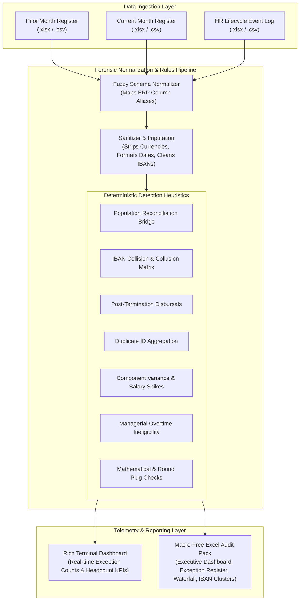

# Payroll Forensic Variance and Integrity Engine

[](https://opensource.org/licenses/MIT)
[](https://www.python.org/)
[]()
[]()
[-success.svg)]()
[](https://www.linkedin.com/in/majid-m-4b097118/)

Continuous controls monitoring (CCM) and forensic variance analytics engine designed to replace manual, 20-employee sample audits with 100% population reconciliation across comparative corporate payroll registers.

Developed by **Majid Mumtaz** (CIA, ACA, FCCA, GRCP, GRCA, COSO ERM Certified) under the Veritux Consulting Network banner.

---

## Fiduciary Context

Payroll represents 25% to 65% of total corporate operating expenditures across service, hospitality, cloud kitchen, healthcare, logistics, and manufacturing sectors. Standard internal audit methodologies evaluate payroll by pulling random 15-to-25 employee sample vouchers once per year.

This legacy approach cannot intercept systemic transaction-level leakages:
- Ghost employees quietly added to decentralized site rosters.
- Collusion rings where site supervisors or payroll clerks route payouts for multiple worker IDs into a single personal bank account.
- Post-termination salary payments continuing after visa cancellation or exit clearance.
- Unapproved managerial basic salary increases disguised within gross compensation lines.
- Duplicate disbursement vouchers generated across split batch files in the same monthly run.

The Payroll Forensic Variance and Integrity Engine performs complete population reconciliation between any two consecutive payroll periods. It ingests source register files directly from ERP exports, standardizes disparate schemas through fuzzy column mapping, sanitizes messy currency and date formats, applies seven deterministic forensic anomaly heuristics, and compiles an executive-grade 4-tab macro-free Excel workbook in seconds.

---

## Technical Architecture



---

## Forensic Heuristics & Rules

The engine runs seven deterministic detection rules across every line item in the payroll population.

### 1. Population Reconciliation Bridge
The engine establishes an exact headcount roll-forward from Month M-1 to Month M. It tallies starting headcount, validated joiners, verified leavers, and ending headcount. Any record appearing in Month M that lacks an authorized hiring log entry is quarantined as an unvalidated addition and flagged for ghost employee verification.

### 2. Bank IBAN Collision and Collusion Matrix
The engine strips whitespace and country code anomalies from banking numbers, filters out null placeholders, and maps all employee records against a unified IBAN hash table. When two or more distinct employee IDs share the identical bank account number, the engine isolates the cluster, totals the cumulative disbursement, and flags the records as critical collusion risks.

### 3. Post-Termination Disbursals
When an optional HR lifecycle log is supplied, the engine matches active payroll disbursements against recorded termination dates, visa cancellations, and exit clearances. Any individual receiving salary for a period beyond their confirmed departure date is flagged with the exact overpayment exposure amount.

### 4. Intra-Register Duplicate ID Aggregation
Where fragmented payroll files or multiple job codes cause an employee to appear on multiple payment vouchers within the same register, the engine aggregates their earnings components to preserve true cash flow reconciliation while raising an immediate duplicate voucher exception.

### 5. Line-Item Variance Waterfall and Base Salary Spikes
Every compensation component (Basic, Allowances, Overtime, Deductions, Gross, and Net) is tracked across consecutive months for each employee. The engine flags basic pay increases exceeding a configurable threshold (default 15%) that lack corresponding promotional authorization in the HR log.

### 6. Overtime Entitlement and Policy Verification
The engine evaluates job designations and grade levels against operational overtime policies. Managerial, director, and executive grade records that draw overtime disbursements are isolated as governance policy overrides.

### 7. Statutory Logic and Round-Number Plugs
The engine checks the internal mathematical integrity of every record. Negative deductions causing net pay to exceed gross earnings are flagged. In addition, round-number net pay figures (e.g., exactly 5,000 or 10,000) that deviate from established contract scales are highlighted for manual plug reviews.

---

## Installation

### Prerequisites
- Python 3.9, 3.10, 3.11, 3.12, or 3.13
- Git

### Standard Installation
Clone the repository and install dependencies:

```bash
git clone https://github.com/majidrajpar/payroll-forensic-variance-engine.git
cd payroll-forensic-variance-engine
pip install -r requirements.txt
```

### Development or System Installation
Install the package directly to expose the global `payroll-audit-engine` CLI command:

```bash
pip install .
```

---

## Usage Guide

The engine supports interactive drag-and-drop terminal execution, single-click Windows batch launching, and headless CLI execution for automated scheduled audits.

### Interactive Terminal Mode
Run the engine without arguments:

```bash
python payroll_audit_engine.py
```

The interactive terminal will prompt for the required file paths. On Windows or macOS, you can drag files directly from File Explorer or Finder into the prompt:

1. Path to Prior Month Payroll Register (`.xlsx` or `.csv`)
2. Path to Current Month Payroll Register (`.xlsx` or `.csv`)
3. Path to optional HR Movement Log (`.xlsx` or `.csv`, or press Enter to skip)
4. Path to output report file (press Enter to accept default timestamped filename)

### Command-Line Headless Execution
For automated data pipelines, continuous controls monitoring (CCM) jobs, and batch scripts, pass all parameters via CLI flags:

```bash
payroll-audit-engine \
  --prior examples/sample_data/Payroll_Register_M01.xlsx \
  --current examples/sample_data/Payroll_Register_M02.xlsx \
  --hr examples/sample_data/HR_Movement_Log.xlsx \
  --output Payroll_Forensic_Audit_Report.xlsx \
  --spike-threshold 0.15 \
  --round-threshold 1000.0 \
  --non-interactive
```

### CLI Flag Reference
The available command-line arguments are structured as follows:

| Flag | Short | Description | Default |
| :--- | :---: | :--- | :--- |
| `--prior` | `-p` | Path to prior month payroll register (`.xlsx` or `.csv`) | None (Interactive) |
| `--current` | `-c` | Path to current month payroll register (`.xlsx` or `.csv`) | None (Interactive) |
| `--hr` | | Path to optional HR movement log (`.xlsx` or `.csv`) | None (Optional) |
| `--output` | `-o` | Destination path for the generated Excel audit pack | Timestamped file |
| `--spike-threshold` | `-s` | Basic pay variance threshold triggering salary spike alert | `0.15` (15%) |
| `--round-threshold` | `-r` | Net pay round number threshold triggering plug alert | `1000.0` |
| `--non-interactive` | `-n` | Disables interactive prompts; aborts on missing paths | Disabled |

---

## Example Data and Stress Testing

The repository provides example datasets and automated tests in structured subdirectories:

- `examples/sample_data/`: Contains synthetic Month 1 and Month 2 registers along with an HR lifecycle log for a 250-employee workforce with seeded red flags.
- `tests/`: Contains the automated stress test suite verifying numeric sanitization, collision detection, edge-case imputation, and scalability.

### Regenerating Example Data
To rebuild or customize the synthetic test dataset:

```bash
python examples/generate_sample_payroll_data.py
```

### Executing the Test Suite
To run the automated verification suite:

```bash
python tests/test_stress_payroll_engine.py
```

The test runner processes a simulated 10,000-employee population across two monthly registers in under 3.5 seconds on standard commercial hardware.

---

## Audit Output Workbook Architecture

The engine outputs a formatted, macro-free `.xlsx` workbook styled for executive presentation and audit working paper documentation.

### Tab 1: Executive Dashboard
Contains high-level summary cards displaying total payroll expenditure, net financial variance, active headcount movements, and exception counts broken down by severity (Critical, High, Medium). Includes a formatted headcount reconciliation table and department-level expenditure allocations.

### Tab 2: Exception Register
Presents every detected anomaly in an actionable audit matrix. Each line includes the employee ID, employee name, department, designation, specific rule triggered, calculated exposure amount, detailed operational description, and blank audit work-paper sign-off columns (Auditor Initials, Disposition Status, Management Response).

### Tab 3: Variance Waterfall
Provides an individual-level comparative breakdown for all employees across the workforce. Displays prior month basic, allowances, overtime, gross, deductions, and net figures directly alongside current month figures and net dollar variances.

### Tab 4: Duplicate IBAN Clusters
Isolates all instances where multiple worker records share identical banking coordinates. Groups the records by IBAN, identifies all associated employee names, and computes the cumulative monthly cash exposure routed to the common account.

---

## Enterprise ERP Schema Compatibility

The engine incorporates fuzzy string matching across raw ERP column headers, allowing it to ingest exports without manual column re-ordering:

| Canonical Field | Recognized Header Aliases |
| :--- | :--- |
| Employee ID | `emp_id`, `employee_id`, `empid`, `staff_id`, `personnel_no`, `payroll_id`, `badge_id`, `worker_id` |
| Employee Name | `name`, `employee_name`, `staff_name`, `full_name`, `person_name`, `worker_name` |
| Department | `department`, `dept`, `cost_center`, `cost_centre`, `business_unit`, `division`, `function`, `team` |
| Designation | `designation`, `job_title`, `title`, `role`, `position`, `grade`, `level`, `post` |
| Basic Pay | `basic_pay`, `basic_salary`, `base_pay`, `base_salary`, `basic`, `fixed_salary`, `monthly_basic` |
| Allowances | `allowances`, `allowance`, `total_allowances`, `housing_allowance`, `transport_allowance` |
| Overtime | `overtime`, `ot`, `ot_pay`, `overtime_pay`, `ot_amount`, `extra_hours_pay` |
| Deductions | `deductions`, `total_deductions`, `deduction`, `tax_deductions`, `withholdings` |
| Gross Pay | `gross_pay`, `gross_salary`, `gross`, `total_gross`, `total_earnings` |
| Net Pay | `net_pay`, `net_salary`, `net`, `take_home`, `total_net`, `net_payable`, `transfer_amount` |
| Bank IBAN | `bank_iban`, `iban`, `account_number`, `bank_account`, `account_no`, `bank_acc` |

---

## Contributing

Contributions from internal audit directors, forensic accountants, and data engineers are welcome. Please read [CONTRIBUTING.md](CONTRIBUTING.md) for details on code style, testing requirements, and the pull request submission process.

---

## Author & Advisory Context

Designed and maintained by **Majid Mumtaz** (CIA, ACA, FCCA, GRCP, GRCA, COSO ERM Certified).

- Professional Profile: [LinkedIn](https://www.linkedin.com/in/majid-m-4b097118/)
- Thought Leadership & Tools: [Portfolio](https://majidrajpar.github.io/portfolio_my)
- Advisory Network: Veritux Consulting Network

For enterprise continuous controls monitoring implementations, ERP connectors (SAP, Oracle Cloud, Workday, Dynamics), or forensic investigation retainers, contact via LinkedIn or directly through the Veritux portal.

---

## License

This software is released under the [MIT License](LICENSE). Copyright (c) 2026 Majid Mumtaz (Veritux Consulting Network).
